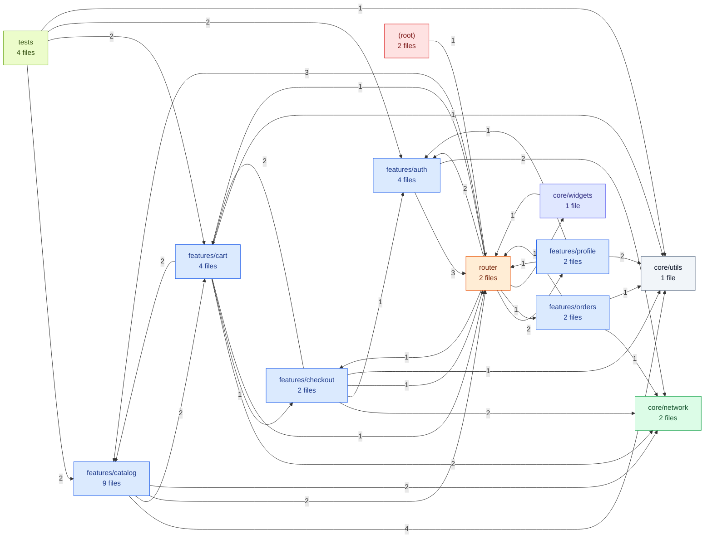
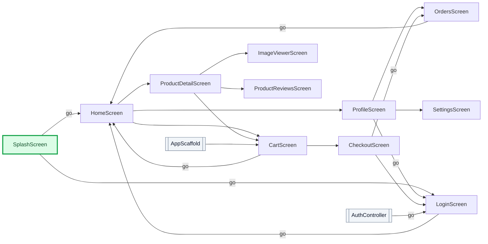

# flutter_shop — Architecture

_Generated by [MobileRepoMap](https://github.com/ananya-kaul/mobile-repo-map) v0.1.0 on 2026-10-12. Static analysis — verify before relying on it._

## At a glance

| Metric | Value |
| --- | --- |
| Files | 35 (31 source, 4 test) |
| Lines of code | 1,679 |
| Modules | 12 |
| Screens | 11 |
| Routes | 10 |
| Navigation edges | 19 |
| API endpoints | 14 (+2 plain URL literals) |
| Tests | 4 test files · 7/31 source files have a test (23%) |
| Import cycles | 1 |
| Average complexity | 5.8 |
| Health score | **71/100** (grade B) |

**Stack**

- **Platforms:** flutter
- **State management:** Riverpod
- **Navigation:** go_router, Navigator
- **Networking:** dio
- **Storage:** shared_preferences
- **Backend:** Firebase

5 declared dependencies

`cloud_firestore`, `dio`, `flutter_riverpod`, `go_router`, `shared_preferences`

## Module map

Node color = dominant file role (entry, screen, widget, router, service, util, test). Edge labels = number of imports from one module into the other.

| Module | Files | LOC | Dominant role | Roles |
| --- | ---: | ---: | --- | --- |
| `features/catalog` | 9 | 458 | screen | screen 4, widget 2, state 1, repository 1, other 1 |
| `features/checkout` | 2 | 345 | screen | screen 1, state 1 |
| `features/cart` | 4 | 210 | screen | screen 1, state 1, repository 1, other 1 |
| `features/auth` | 4 | 183 | screen | screen 2, state 1, repository 1 |
| `features/profile` | 2 | 128 | screen | screen 2 |
| `tests` | 4 | 126 | test | test 4 |
| `features/orders` | 2 | 118 | screen | screen 1, repository 1 |
| `router` | 2 | 94 | router | router 2 |
| `core/network` | 2 | 52 | service | service 2 |
| `core/utils` | 1 | 47 | util | util 1 |
| `core/widgets` | 1 | 23 | widget | widget 1 |
| `(root)` | 2 | 21 | entry | entry 1, widget 1 |

## Navigation

Green, thick-bordered nodes are entry points. Dotted arrows are modal presentations; arrow labels name the transition when it is not a plain push.

### Routes

| Path | Screen | File | Source |
| --- | --- | --- | --- |
| `/splash` | SplashScreen | `lib/router/app_router.dart:21` | go_router |
| `/login` | LoginScreen | `lib/router/app_router.dart:26` | go_router |
| `/` | HomeScreen | `lib/router/app_router.dart:31` | go_router |
| `/product/:id` | ProductDetailScreen | `lib/router/app_router.dart:36` | go_router |
| `/product/:id/reviews` | ProductReviewsScreen | `lib/router/app_router.dart:43` | go_router |
| `/cart` | CartScreen | `lib/router/app_router.dart:52` | go_router |
| `/checkout` | CheckoutScreen | `lib/router/app_router.dart:57` | go_router |
| `/orders` | OrdersScreen | `lib/router/app_router.dart:62` | go_router |
| `/profile` | ProfileScreen | `lib/router/app_router.dart:70` | go_router |
| `/settings` | SettingsScreen | `lib/router/app_router.dart:75` | go_router |

## Screens

| Screen | Kind | Routes | File |
| --- | --- | --- | --- |
| CartScreen | widget | `/cart` | `lib/features/cart/presentation/cart_screen.dart:9` |
| CheckoutScreen | widget | `/checkout` | `lib/features/checkout/presentation/checkout_screen.dart:11` |
| HomeScreen | widget | `/` | `lib/features/catalog/presentation/home_screen.dart:12` |
| ImageViewerScreen | widget | — | `lib/features/catalog/presentation/image_viewer_screen.dart:3` |
| LoginScreen | widget | `/login` | `lib/features/auth/presentation/login_screen.dart:8` |
| OrdersScreen | widget | `/orders` | `lib/features/orders/presentation/orders_screen.dart:10` |
| ProductDetailScreen | widget | `/product/:id` | `lib/features/catalog/presentation/product_detail_screen.dart:11` |
| ProductReviewsScreen | widget | `/product/:id/reviews` | `lib/features/catalog/presentation/product_reviews_screen.dart:7` |
| ProfileScreen | widget | `/profile` | `lib/features/profile/presentation/profile_screen.dart:9` |
| SettingsScreen | widget | `/settings` | `lib/features/profile/presentation/settings_screen.dart:7` |
| SplashScreen _(entry)_ | widget | `/splash` | `lib/features/auth/presentation/splash_screen.dart:7` |

## API surface

**Base URLs**

- `https://api.flutter-shop.dev/v1` — `lib/core/network/api_client.dart:13`

### api.flutter-shop.dev (12)

| Method | Endpoint | Client | File | Used by |
| --- | --- | --- | --- | --- |
| `DELETE` | `/cart/items/{itemId}` | dio | `lib/features/cart/data/cart_repository.dart:33` | CartScreen, CheckoutScreen, HomeScreen, ProductDetailScreen |
| `PATCH` | `/cart/items/{itemId}` | dio | `lib/features/cart/data/cart_repository.dart:29` | CartScreen, CheckoutScreen, HomeScreen, ProductDetailScreen |
| `GET` | `/products/{id}` | dio | `lib/features/catalog/data/product_repository.dart:26` | HomeScreen, ProductDetailScreen, ProductReviewsScreen |
| `GET` | `/products/{id}/reviews` | dio | `lib/features/catalog/data/product_repository.dart:31` | HomeScreen, ProductDetailScreen, ProductReviewsScreen |
| `GET` | `true` | dio | `lib/features/cart/data/cart_repository.dart:18` | CartScreen, CheckoutScreen, HomeScreen, ProductDetailScreen |
| `GET` | `true` | dio | `lib/features/catalog/data/product_repository.dart:14` | HomeScreen, ProductDetailScreen, ProductReviewsScreen |
| `GET` | `true` | dio | `lib/features/orders/data/orders_repository.dart:40` | OrdersScreen |
| `POST` | `true` | dio | `lib/features/auth/data/auth_repository.dart:29` | CheckoutScreen, LoginScreen, ProfileScreen |
| `POST` | `true` | dio | `lib/features/auth/data/auth_repository.dart:41` | CheckoutScreen, LoginScreen, ProfileScreen |
| `POST` | `true` | dio | `lib/features/cart/data/cart_repository.dart:24` | CartScreen, CheckoutScreen, HomeScreen, ProductDetailScreen |
| `POST` | `true` | dio | `lib/features/checkout/application/checkout_service.dart:45` | CheckoutScreen |
| `POST` | `true` | dio | `lib/features/checkout/application/checkout_service.dart:62` | CheckoutScreen |

### firebase (2)

| Method | Endpoint | Client | File | Used by |
| --- | --- | --- | --- | --- |
| `FIRESTORE` | `true` | firestore | `lib/features/orders/data/orders_repository.dart:48` | OrdersScreen |
| `FIRESTORE` | `true` | firestore | `lib/features/orders/data/orders_repository.dart:65` | OrdersScreen |

2 plain URL literals

| URL | File | Used by |
| --- | --- | --- |
| `true` | `lib/core/network/api_config.dart:4` | CartScreen, CheckoutScreen, HomeScreen, LoginScreen, OrdersScreen, ProductDetailScreen, ProductReviewsScreen, ProfileScreen |
| `true` | `lib/features/profile/presentation/settings_screen.dart:10` | SettingsScreen |

## Risks

### Import cycles

1 import cycle — groups of files that import each other directly or indirectly:

- **Cycle 1** — 2 files
  - `lib/features/cart/data/cart_repository.dart` → `lib/features/checkout/application/checkout_service.dart` → `lib/features/cart/data/cart_repository.dart`

### Module cycles

- `core/widgets` ↔ `features/auth` ↔ `features/cart` ↔ `features/catalog` ↔ `features/checkout` ↔ `features/orders` ↔ `features/profile` ↔ `router`

### Most complex files

| File | Score | Reasons |
| --- | ---: | --- |
| `lib/features/checkout/presentation/checkout_screen.dart` | 4.9 | build() has complexity 63 |

### Hotspots

_No git history available — hotspot analysis skipped._

### Test coverage by role

| Role | Files | Tested | Coverage |
| --- | ---: | ---: | ---: |
| screen | 11 | 0 | 0% |
| widget | 4 | 1 | 25% |
| state | 4 | 1 | 25% |
| router | 2 | 0 | 0% |
| service | 2 | 0 | 0% |
| repository | 4 | 2 | 50% |

18 untested source files

- `lib/core/network/api_client.dart`
- `lib/core/network/api_config.dart`
- `lib/features/auth/presentation/login_screen.dart`
- `lib/features/auth/presentation/splash_screen.dart`
- `lib/features/cart/application/cart_controller.dart`
- `lib/features/cart/presentation/cart_screen.dart`
- `lib/features/catalog/application/catalog_providers.dart`
- `lib/features/catalog/data/product_repository.dart`
- `lib/features/catalog/presentation/home_screen.dart`
- `lib/features/catalog/presentation/image_viewer_screen.dart`
- `lib/features/catalog/presentation/product_detail_screen.dart`
- `lib/features/catalog/presentation/product_reviews_screen.dart`
- `lib/features/checkout/application/checkout_service.dart`
- `lib/features/checkout/presentation/checkout_screen.dart`
- `lib/features/orders/data/orders_repository.dart`
- `lib/features/orders/presentation/orders_screen.dart`
- `lib/features/profile/presentation/profile_screen.dart`
- `lib/features/profile/presentation/settings_screen.dart`

### God files

_No god files detected._

## Health score

Overall: **71/100** (grade B)

| Factor | Penalty | Detail |
| --- | ---: | --- |
| Import cycles | -3 | 1 cycle involving 2 files |
| Module cycles | -2 | 1 folder-level cycle |
| Complexity | -3 | 1 of 31 files exceed size/complexity thresholds |
| Test coverage | -21 | 3 of 21 screens/state/services/repositories have tests |
