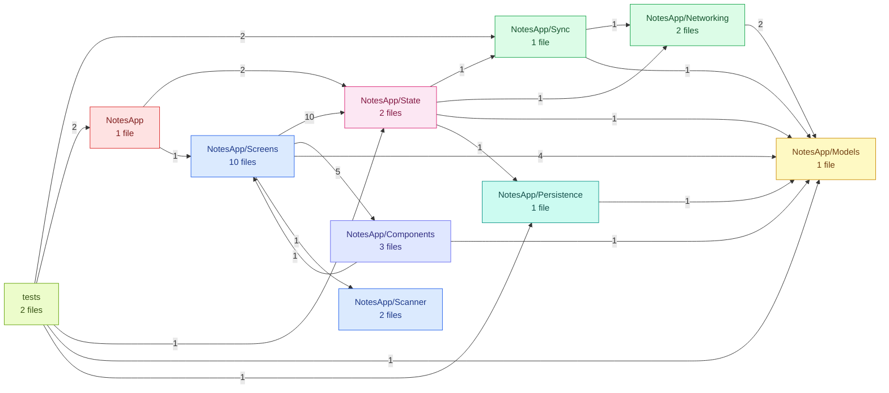
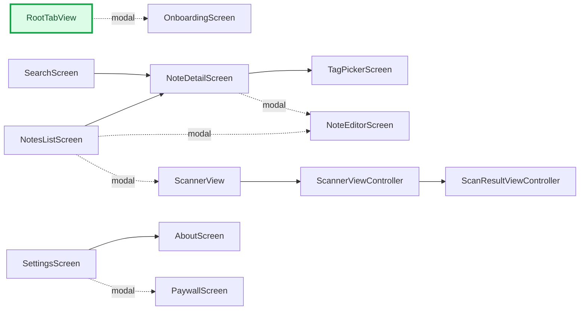

# NotesApp — Architecture

_Generated by [MobileRepoMap](https://github.com/ananya-kaul/mobile-repo-map) v0.1.0 on 2026-10-12. Static analysis — verify before relying on it._

## At a glance

| Metric | Value |
| --- | --- |
| Files | 25 (23 source, 2 test) |
| Lines of code | 1,190 |
| Modules | 10 |
| Screens | 13 |
| Routes | 0 |
| Navigation edges | 11 |
| API endpoints | 7 (+3 plain URL literals) |
| Tests | 2 test files · 5/23 source files have a test (22%) |
| Import cycles | 0 |
| Average complexity | 7.1 |
| Health score | **70/100** (grade B) |

**Stack**

- **Platforms:** ios
- **State management:** Combine, ObservableObject, @Observable
- **Navigation:** NavigationStack, UINavigationController
- **Networking:** URLSession, Alamofire
- **Storage:** UserDefaults
- **Backend:** _none detected_

1 declared dependency

`Alamofire`

## Module map

Node color = dominant file role (entry, screen, widget, state, service, repository, model, test). Edge labels = number of imports from one module into the other.

| Module | Files | LOC | Dominant role | Roles |
| --- | ---: | ---: | --- | --- |
| `NotesApp/Screens` | 10 | 472 | screen | screen 10 |
| `NotesApp/Sync` | 1 | 175 | service | service 1 |
| `NotesApp/State` | 2 | 132 | state | state 2 |
| `NotesApp/Scanner` | 2 | 120 | screen | screen 2 |
| `NotesApp/Networking` | 2 | 114 | service | service 2 |
| `tests` | 2 | 104 | test | test 2 |
| `NotesApp/Components` | 3 | 66 | widget | widget 3 |
| `NotesApp/Models` | 1 | 63 | model | model 1 |
| `NotesApp/Persistence` | 1 | 35 | repository | repository 1 |
| `NotesApp` | 1 | 13 | entry | entry 1 |

## Navigation

Green, thick-bordered nodes are entry points. Dotted arrows are modal presentations; arrow labels name the transition when it is not a plain push.

### Routes

_No routes detected._

## Screens

| Screen | Kind | Routes | File |
| --- | --- | --- | --- |
| AboutScreen | swiftui | — | `NotesApp/Screens/AboutScreen.swift:3` |
| NoteDetailScreen | swiftui | — | `NotesApp/Screens/NoteDetailScreen.swift:3` |
| NoteEditorScreen | swiftui | — | `NotesApp/Screens/NoteEditorScreen.swift:3` |
| NotesListScreen | swiftui | — | `NotesApp/Screens/NotesListScreen.swift:3` |
| OnboardingScreen | swiftui | — | `NotesApp/Screens/OnboardingScreen.swift:3` |
| PaywallScreen | swiftui | — | `NotesApp/Screens/PaywallScreen.swift:3` |
| RootTabView _(entry)_ | swiftui | — | `NotesApp/Screens/RootTabView.swift:3` |
| ScannerView | swiftui | — | `NotesApp/Scanner/ScannerViewController.swift:7` |
| ScannerViewController | uikit | — | `NotesApp/Scanner/ScannerViewController.swift:17` |
| ScanResultViewController | uikit | — | `NotesApp/Scanner/ScanResultViewController.swift:3` |
| SearchScreen | swiftui | — | `NotesApp/Screens/SearchScreen.swift:3` |
| SettingsScreen | swiftui | — | `NotesApp/Screens/SettingsScreen.swift:3` |
| TagPickerScreen | swiftui | — | `NotesApp/Screens/TagPickerScreen.swift:3` |

## API surface

**Base URLs**

- `https://api.notesapp.dev` — `NotesApp/Networking/APIClient.swift:4`

### api.notesapp.dev (6)

| Method | Endpoint | Client | File | Used by |
| --- | --- | --- | --- | --- |
| `API` | `true` | Endpoint.notes | `NotesApp/Networking/APIClient.swift` | NoteDetailScreen, NoteEditorScreen, NotesListScreen, RootTabView, SearchScreen, SettingsScreen, TagPickerScreen |
| `API` | `true` | Endpoint.sync | `NotesApp/Networking/APIClient.swift` | NoteDetailScreen, NoteEditorScreen, NotesListScreen, RootTabView, SearchScreen, SettingsScreen, TagPickerScreen |
| `API` | `true` | Endpoint.tags | `NotesApp/Networking/APIClient.swift` | NoteDetailScreen, NoteEditorScreen, NotesListScreen, RootTabView, SearchScreen, SettingsScreen, TagPickerScreen |
| `POST` | `true` | URLSession | `NotesApp/Networking/APIClient.swift:42` | NoteDetailScreen, NoteEditorScreen, NotesListScreen, RootTabView, SearchScreen, SettingsScreen, TagPickerScreen |
| `POST` | `true` | Alamofire | `NotesApp/Networking/SyncTransport.swift:33` | NoteDetailScreen, NoteEditorScreen, NotesListScreen, RootTabView, SearchScreen, SettingsScreen, TagPickerScreen |
| `GET` | `{url}` | URLSession | `NotesApp/Networking/APIClient.swift:53` | NoteDetailScreen, NoteEditorScreen, NotesListScreen, RootTabView, SearchScreen, SettingsScreen, TagPickerScreen |

### realtime.notesapp.dev (1)

| Method | Endpoint | Client | File | Used by |
| --- | --- | --- | --- | --- |
| `WS` | `true` | URLSession | `NotesApp/Networking/APIClient.swift:73` | NoteDetailScreen, NoteEditorScreen, NotesListScreen, RootTabView, SearchScreen, SettingsScreen, TagPickerScreen |

3 plain URL literals

| URL | File | Used by |
| --- | --- | --- |
| `true` | `NotesApp/Networking/APIClient.swift:35` | NoteDetailScreen, NoteEditorScreen, NotesListScreen, RootTabView, SearchScreen, SettingsScreen, TagPickerScreen |
| `true` | `NotesApp/Screens/AboutScreen.swift:17` | AboutScreen, SettingsScreen |
| `true` | `NotesApp/Screens/AboutScreen.swift:18` | AboutScreen, SettingsScreen |

## Risks

### Import cycles

_No import cycles detected._

### Module cycles

- `NotesApp/Components` ↔ `NotesApp/Screens`

### Most complex files

| File | Score | Reasons |
| --- | ---: | --- |
| `NotesApp/Sync/SyncEngine.swift` | 2.9 | plan() has complexity 24 |
| `NotesApp/Screens/NotesListScreen.swift` | 1.8 | nesting depth 11 |

### Hotspots

_No git history available — hotspot analysis skipped._

### Test coverage by role

| Role | Files | Tested | Coverage |
| --- | ---: | ---: | ---: |
| screen | 12 | 0 | 0% |
| widget | 3 | 0 | 0% |
| state | 2 | 1 | 50% |
| service | 3 | 1 | 33% |
| repository | 1 | 1 | 100% |
| model | 1 | 1 | 100% |

15 untested source files

- `NotesApp/Networking/APIClient.swift`
- `NotesApp/Networking/SyncTransport.swift`
- `NotesApp/Scanner/ScannerViewController.swift`
- `NotesApp/Scanner/ScanResultViewController.swift`
- `NotesApp/Screens/AboutScreen.swift`
- `NotesApp/Screens/NoteDetailScreen.swift`
- `NotesApp/Screens/NoteEditorScreen.swift`
- `NotesApp/Screens/NotesListScreen.swift`
- `NotesApp/Screens/OnboardingScreen.swift`
- `NotesApp/Screens/PaywallScreen.swift`
- `NotesApp/Screens/RootTabView.swift`
- `NotesApp/Screens/SearchScreen.swift`
- `NotesApp/Screens/SettingsScreen.swift`
- `NotesApp/Screens/TagPickerScreen.swift`
- `NotesApp/State/SettingsModel.swift`

### God files

_No god files detected._

## Health score

Overall: **70/100** (grade B)

| Factor | Penalty | Detail |
| --- | ---: | --- |
| Module cycles | -2 | 1 folder-level cycle |
| Complexity | -7 | 2 of 23 files exceed size/complexity thresholds |
| Test coverage | -21 | 3 of 18 screens/state/services/repositories have tests |
